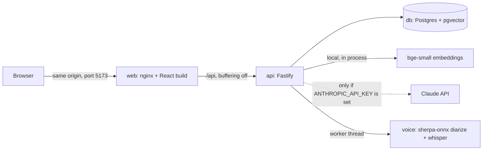

# Meeting Intelligence

Ask questions about your meeting transcripts and get answers that cite the exact moment something was said.

My submission for option 3 of the take-home brief (Meeting Intelligence System): a React front end and a Fastify API, both in TypeScript, with Postgres and pgvector. The README follows the brief's sections a to i. Longer reasoning for each decision is in `docs/adr/`.

## Demo

https://github.com/user-attachments/assets/5d9033a7-7a7f-4296-bd93-bee48e8ad66f

Three minutes, captioned, no sound, recorded from the running app: a cited answer, "Why this answer", a refusal, the planted injection line, extraction, voice from upload to a cited answer, and the no-key mode. The voice wait is shown at 4x speed. If the player does not load, the file is [`docs/demo/meeting-intelligence-demo.mp4`](docs/demo/meeting-intelligence-demo.mp4).

## Screenshots


**Ask, full mode.** Every claim ends in a chip with the time and speaker. Clicking one scrolls the transcript to that turn and highlights it. Only citations that the server checked against the retrieved turns become chips.


**Why this answer.** Tokens, latency per stage, an estimated cost, and every retrieved chunk with its vector and full-text rank and score. Each chunk is marked cited or not cited.


**Review before import.** A person names the speakers, merges any that were split, or re-runs with a set speaker count. Nothing is saved until Import, and the audio is never stored.

All 11 screenshots, with captions: [`docs/screenshots/`](docs/screenshots/README.md).

## a. Quick setup

You need Docker with Compose v2.

```
git clone https://github.com/christosgalaios/meeting-intelligence.git
cd meeting-intelligence
docker compose up --build
```

Open <http://127.0.0.1:5173>. Use the IP rather than `localhost`: every port is bound to 127.0.0.1 only.

- **No key needed.** Without one the app runs in retrieval-only mode: upload, search, and ranked speaker turns with timestamps, but no written answers or extraction (ADR 0001).
- **With your own Claude key,** copy `.env.example` to `.env`, set `ANTHROPIC_API_KEY`, and run the same command. The key stays in the API container. Nothing paid runs without a click, and every paid button shows its estimated cost first.
- **The first build is slow** because the embedding and voice models are baked into the image. After that it needs no network. Four sample meetings load at start, and a **Load sample meetings** button brings them back if the library is empty.
- **Transcripts** are `.txt` files or pasted text, one turn per line: `[00:12:04] Priya Raman: Then let's decide it.` Files that do not look like transcripts are rejected before anything is embedded.
- **Audio:** press **Transcribe audio**, review the speakers, then Import. It runs locally at about 13.5 seconds per minute of audio, and the audio is never stored.
- `docker compose down` stops it. Add `-v` to delete the data.

For development without Docker (Node 24):

```
docker compose up -d db
npm install
npm run dev --workspace apps/api    # API on 3001
npm run dev --workspace apps/web    # web on 5173, in a second terminal
npm test && npm run eval
```

## b. Architecture

Three containers. The browser talks only to nginx, which serves the React app and proxies `/api` to the API. The API owns the database, the embeddings and every model call.



**How a question is answered.**
1. The question is embedded locally. Postgres returns the 20 nearest chunks by vector and the 20 best chunks by full-text rank.
2. The two lists are fused with reciprocal rank fusion and the top 8 chunks are kept.
3. If the evidence is weak, the app refuses without calling a model.
4. Otherwise the turns inside those chunks go to Claude Sonnet, which answers with `[meeting#turn]` citations. Tokens stream to the browser as server-sent events.
5. The server checks every citation against the turns it retrieved. Unverified ones are dropped from the answer's citations and recorded.
6. Every question writes a trace row, which the "Why this answer" panel and `GET /api/traces/:id` both read.

**Stack.**

| Layer | Choice |
|---|---|
| Language | TypeScript, strict mode, in both apps |
| API | Fastify 5, zod, Pino logging |
| Database | Postgres 17 with pgvector (HNSW) and full-text search |
| Embeddings | `Xenova/bge-small-en-v1.5`, 384 dimensions, run locally with `@huggingface/transformers` |
| Answers | `claude-sonnet-5-5` through the Anthropic SDK, streamed |
| Extraction | `claude-haiku-5-5`, structured output |
| Speech-to-text | sherpa-onnx in a worker thread: pyannote segmentation 3.0, wespeaker resnet34, Whisper base.en int8. Local, English, no key |
| Web | React 19, Vite, Tailwind 4, React Router, design tokens in CSS variables |
| Serving | nginx, same origin, no CORS |
| Tests | Vitest in both apps, Testing Library for the web |
| CI | GitHub Actions: typecheck, lint, tests, retrieval eval, build, compose smoke test, gitleaks |

Ingest, voice transcription, the SSE event order, the data model and the request lifecycle are drawn in `docs/architecture.md`.

## c. Productionising and scaling

Today this is a single-tenant app that runs on one machine with no login. That is fine for a demo. Hosting it for real users needs the following, roughly in this order.

**1. Authorisation and rate limiting.** Anyone who can reach the API can spend the key, which is why every port is bound to localhost. Before any public URL I would add authentication, an owner on every meeting so one customer cannot read another's transcripts, and rate limits per user and per IP in front of the paid endpoints. The tables have no owner column yet, so this is a migration, not a flag.

**2. Safeguards on LLM spend.** Today the safeguard is that nothing paid runs without a click, and the estimated cost is shown before you click. With many users that is not enough. I would add a budget per user and per organisation, a cap on tokens per request, and a spend limit on the provider key as the last line of defence. The trace table already records the tokens for every question, so the usage data is there.

**3. Where to host it.** My preference is Cloudflare, because I know it from running Socialise. In a company I would first look at what is already in use and adapt to that. Nothing in the app depends on one provider. The three containers already exist with healthchecks, so the move is a container platform for `web` and `api`, a managed Postgres with pgvector, and a secrets manager for the key. Answers stream, so the load balancer's idle timeout has to be long enough not to cut them off.

**4. Slow work off the request.** Embedding runs inside the upload request, extraction runs in the API process with no retry, and the voice job queue lives in memory. In production all three become background jobs with a status, retries with a limit, and somewhere for failed jobs to land.

**5. Logging and error tracking.** The logs are structured and every question has a trace row, but in Docker they only go to the container's output. Hosted, I would make sure the logs are written and kept on the server, add Sentry or something similar for errors, and add metrics (retrieval latency, model latency, refusal rate, dropped citations) with alerts.

**6. More than one instance.** Migrations run at boot with no lock, so two API replicas starting together could both try to apply one. Voice jobs are held per instance. Both need changing before scaling out.

**7. Data protection.** Transcripts are personal data. A hosted version needs retention rules, deletion on request, a record of what is sent to the model provider, and a decision on regions. Questions are stored in the trace table, so it needs the same treatment.

## d. RAG and LLM approach

**LLM.** Answers use Claude Sonnet (`claude-sonnet-5-5`), streamed. Decisions and action items are extracted with Claude Haiku (`claude-haiku-5-5`) in one structured call per meeting. Answers combine several meetings and follow citation rules, and extraction is a simpler job over one transcript, so it gets the cheaper model (ADR 0008). The models were not compared on answer quality.

One option I considered was shipping an on-device LLM, so nobody would pay for API calls. I wasn't sure a reviewer would be comfortable putting in their own key, but I decided to build it with a hosted model because that is more production ready. I also considered building a demo mode first, without any key, but that would have taken more iteration. What the app does have is a real no-key mode: embeddings and voice transcription run locally, so without a key you still get real search results over your own transcripts, just not a written answer (ADR 0001).

**Embedding model.** `bge-small-en-v1.5`, 384 dimensions, run locally inside the API. Retrieval is real and free with or without a key. The trade-off is a small model whose similarity scores sit in a narrow band. Only this model was evaluated.

**Vector database.** Postgres with pgvector, with Postgres full-text search next to it. One database holds the meetings, turns, chunks and traces. A separate vector database would be a second system with nothing to gain at this size.

**Orchestration framework.** None. I wanted to keep things simple and straightforward. The flow is a handful of plain functions (embed the question, search, fuse, check, call the model, validate the citations), and it calls the Anthropic SDK directly. A framework would add a layer to learn and debug without doing anything those functions don't. The API wires its parts together by hand in one place (`buildServer`), which is also what lets the tests swap in a fake model and a fake embedder.

**Chunking.** Windows of whole speaker turns: up to 6 turns or 180 words, overlapping by 2 turns. A chunk never cuts a turn in half, so who said what is never lost, and the overlap keeps a question and its answer together when they fall either side of a boundary. The sizes are reasoned, not tuned (ADR 0004).

**Retrieval.** Each question fetches 20 chunks by vector similarity and 20 by full-text rank. Reciprocal rank fusion (k = 60) merges the two lists by position, because the two kinds of score are on different scales and can't be added. The top 8 chunks are kept. The full-text query matches any word of the question rather than every word: with every word required, natural questions matched almost nothing. The switch raised recall@8 from 0.583 to 0.604 and MRR from 0.625 to 0.667 (ADR 0005).

**Prompt and context.** A constant system prompt, so it can be cached. The user message holds the retrieved turns grouped by meeting, each with its id and timestamp, then the question. The model must answer only from those excerpts, cite every claim as `[meeting#turn]`, and reply exactly "Not discussed in these meetings." when the excerpts don't cover the question.

**Guardrails.**
- **Refusal in two layers.** If the best vector score is below 0.58 (and no chunk contains every word of the question), the app refuses without calling the model. That threshold is weak: it catches 1 of the 6 unanswerable eval questions, and raising it starts refusing real ones. The model's own refusal does most of the work. In one live run on 4 November, all 6 unanswerable questions were refused, 1 by the threshold and 5 by the model (ADR 0006).
- **Citations are checked on the server.** A citation is shown as a link only if that turn was in the excerpts the model was given. Anything else stays plain text and is recorded in the trace.
- **Transcripts are data, not instructions.** They are wrapped in tags, with `<` escaped so a speaker can't break out, and the prompt says to treat any instruction inside them as something a speaker said. I chose not to strip suspicious lines: no filter catches every phrasing, and deleting lines would change the meeting record. A sample transcript has a planted "ignore all previous instructions" line, and the model quotes it rather than following it.

**Quality.** A retrieval eval of 22 hand-labelled questions (16 answerable, 6 not) runs the real embedder in CI. It fails the build if recall@8 drops below 0.58 or MRR below 0.64. Current values: recall@8 0.604, MRR 0.667, and 0.849 for recall over everything the model is shown. These numbers moved during the build: a code review found the eval was ranking turns differently from the app, and once it used the app's own ranking, recall@8 went from 0.44 to 0.60. Sixteen answerable questions is a small set, so I treat the numbers as coarse. There is no check yet that an answer is supported by the turns it cites.

**Observability.** Structured logs with a request id on every line, and one trace row per question with the retrieved chunks and their scores, the model, tokens, timings and any dropped citations. The "Why this answer" panel shows that trace in the UI.

## e. Key technical decisions

Each of these has an ADR in `docs/adr/` with the options that were rejected.

- **Option 3, Meeting Intelligence.** I have worked on similar projects to do with meetings, so it seemed like a good learning opportunity.
- **Build it like a proper product, with your own key.** We looked at running answers through my Claude subscription instead of an API key. I decided against it and built it like a proper product: the shipped app uses the reviewer's own key, and there is no hosted demo, since that would put my key behind a public URL.
- **No key still means real results.** The first plan used canned answers when there was no key. A reviewer agent flagged it, and I went with real retrieval instead, so a reviewer without a key can still test it on their own transcripts.
- **Every paid call starts with a click,** and shows its estimated cost first. Seeding the sample meetings never calls a model.
- **Check input before it reaches the parser, the embedder or a model.** When I went through the build decisions, I asked whether we were validating input. A file with one valid line and a lot of junk was being accepted, embedded and sent to extraction. There is now a validation step that rejects that before anything is processed.
- **Two days, with a cut list.** I capped the build at two days and wrote what was cut into section h, instead of half-building it.
- **Gates from measurements.** The CI thresholds for the eval come from measured results, not guesses, so a regression fails the build.
- **A plain UI.** The interface is kept plain and distraction-free, so the focus stays on reading the text.
- **Voice, added back.** Voice was listed as a bonus, and I like going the extra mile. It was also something we had already worked on before, so it was familiar. It runs on-device, free and with no key, and a person reviews the speakers before anything is saved, because similar voices get mixed up (ADR 0011).

## f. Engineering standards

What I followed:

- **Types.** Strict TypeScript. Every request body and every model output is checked with zod before it is used, and each streamed event is checked against the contract before it is sent.
- **Tests.** Unit tests for the parser, chunker, RRF, citations and extraction schema. API tests against a real Postgres with a fake embedder and a fake model, so they need no key. Web tests for the streaming client, ask, upload, voice and the paid extract button. API coverage is about 84% of statements, with no threshold. A bug fix ships with a test that fails without it.
- **A retrieval eval in CI,** with gates set from measured results (section d).
- **CI on every push:** typecheck, lint, tests, the eval, the build, gitleaks, and a smoke test that builds the stack from a clean checkout and streams one question through nginx. None of it needs a key.
- **Containers.** Multi-stage images running as non-root, healthchecks on all three services, ports on 127.0.0.1 only.
- **Observability.** JSON logs with a request id on every line and a line per stage. Errors show the request id in the UI as `Ref: <id>`. One trace row per question. A test fails if transcript text or a key-shaped string reaches an `info` log.
- **Security.** Same origin with no CORS, input checked before embedding, transcripts escaped and wrapped before the model, a Content-Security-Policy, and the key only in the API (CI fails if the web bundle contains `sk-ant`).
- **Database and frontend.** Numbered SQL migrations applied in a transaction at boot. Colours only from design tokens, and lint fails on a stray hex colour.
- **Process.** Branches and pull requests, rules for the agents in `CLAUDE.md`, and decisions written up as ADRs.

What I skipped, and known limits:

- **No login or rate limiting.** Binding to localhost is the only protection (section c).
- **No durable job queue.** Upload embedding is synchronous, extraction runs in the API process with no retry, and voice jobs live in memory and are lost on restart.
- **Voice is thinly tested.** Synthetic voices only, in clips under two minutes. Similar voices get merged or split (1 to 4 speakers found for 3 similar voices), which is why there is a review step. Recordings over 30 minutes are refused. English only.
- **Answer quality is not measured.** The eval measures retrieval on 22 questions. A citation check proves the model cited a turn it was given, not that the turn supports the claim. The refusal threshold on its own catches 1 of 6 unanswerable questions.
- **Plain-text transcripts only,** no WebVTT or SRT, and English only.
- **No browser end-to-end tests, coverage threshold, load testing or deploy pipeline.** Contract types are copied by hand between the two apps.
- **Smaller things.** Migrations take no lock, so this runs as one replica. A few components are long, mostly JSX. The nginx `/assets/` location drops the CSP headers (it serves static files only). `max_tokens` is a constant. The pre-commit secret scan skips itself if gitleaks is not installed; the CI scan always runs.

## g. How I used AI tools

**My role.** Most of the code was written by AI agents in Claude Code. I made the product and scope decisions, set the rules the work had to follow, and decided what was done. An orchestrating Claude session ran the checks I set: it gave work to the agents, never accepted an agent's own "done", and sent work back. My own time was roughly 6 hours spread over three days: two days on the core build, and the third on polish and documentation.

**The setup.**
- **One planner, separate builders, an independent reviewer.** A planning model wrote the spec from the brief and my constraints. Sonnet agents built the backend and frontend to it. An Opus reviewer, given the brief but not my conclusions, reviewed the plan before building and the code after.
- **Rules in the repo.** `CLAUDE.md` lists what every agent must do: the key never leaves the API, no canned answers, validate model output, no automatic LLM calls, a test with every bug fix, show test output before saying done.
- **Checks that don't trust reports.** Run the eval, run the app, look at the build. gitleaks scans for secrets before every commit and in CI.
- **A decision walkthrough.** Claude put 12 build decisions in front of me with their trade-offs. I kept all 12 and raised the input validation question, which became a fix.

**Decisions that were mine.** Option 3, because I'd worked on meeting projects before. Building it like a proper product with your own key, after looking at the subscription route. The two-day cap. No hosted demo, and my development key used only for building, screenshots and the video, on an account with a $1 spend limit. Going with real retrieval when there's no key. Adding voice back, with proper speaker identification. The plain UI. Asking for a cold code review against the brief. Keeping the documentation in step with every scope change.

**What the reviews and checks caught,** and who caught it:
1. **Canned answers as the no-key default** (reviewer agent, in the plan).
2. **CORS open to any origin,** so any web page could spend the key through the reviewer's browser, plus 13 other issues CI couldn't see, including a 2.1 GB image and a fake lint step (independent Opus review of the backend).
3. **A full-text query that matched almost nothing,** because it required every word (the orchestrating session ran the eval).
4. **Seeding that triggered four paid extraction calls** when a key was set (the orchestrating session).
5. **An agent waiting on a build that had already failed** (the orchestrating session checked the artefacts).
6. **An eval that ranked turns differently from the app** (the cold review I asked for).
7. **Input that wasn't validated before embedding** (me, in the walkthrough).

**Do's and don'ts.**
- Do give an agent a spec with acceptance checks. Don't accept "done" from the agent that did the work.
- Do check artefacts, not reports. Most of the catches above came from running the thing.
- Do get reviews from a model that hasn't seen the author's reasoning.
- Do keep the rules in a file the agents read every time, rather than repeating them in chat.
- Don't let an agent decide anything that spends money, exposes a key or changes who can reach the app.

**Learning what I shipped.** Agents write code faster than I can read it. I own the results, and I study and learn. Before writing this up, I went through the parts of the system I couldn't yet explain (embeddings, chunking, hybrid search and RRF, the eval metrics, refusal, prompt injection and citation checks) until I could. In a normal working environment I would carry on until I knew all of it.

**Repeatable.** The spec, `CLAUDE.md`, the ADRs, the eval and CI are all in the repo. A new person or a new agent gets the rules and the reasons, and the eval fails the build if retrieval gets worse.

## h. What I'd do with more time

**With one more day,** I would focus on testing and edge cases, not features, and on reading and understanding the code more. The goal would be more confidence that the tool is reliable.

**Accuracy.** Test more and find ways to improve the results: a bigger eval set built from real questions, a check that each answer is supported by the turns it cites, tuning the chunk size, and trying a reranker. Each change measured with the eval, one at a time.

**Audio.** Find out whether the transcription is good enough for real use. So far it has only been tested on synthetic voices, in clips under two minutes, with nobody talking over anybody. Next is real conversations with several people and overlapping voices, measuring the word error rate and how often speakers get mixed up.

**Who the users are.** I would question who the expected users are, and whether they care about cost. If it's a product someone is paying for, I would tidy up the front end and hide what end users don't need: the cost on every button, the "Why this answer" panel, and the numbers behind it. They are in this demo on purpose, for transparency. In a product they would move to an admin or support view.

**Organising meetings.** Archive meetings, and group them into projects. As the library grows, more near-misses compete for the same top 8 chunks, so asking within a project gives cleaner answers. The cost per question stays flat, because it always sends the same number of chunks. You can already pick which meetings a question searches. A project would make that selection something you save. A calendar to browse past meetings would help too, since each meeting already has a date.

**A connect layer,** for input or output. In: pull transcripts from Zoom, Teams or Google Meet. Out: send action items to Slack, email or a ticket tracker, always with a person confirming first.

**Other LLM providers.** Support for more than one provider, so it isn't locked to Anthropic, or an on-device model self-hosted on AWS. That is an option, and it depends on cost, for example if we wanted to keep it free.

**From the original cut list.** WebVTT and other transcript formats, speaker and date filters, end-to-end tests that drive the UI, and a shared types package between the API and the web app.

Hosting it for real users is section c.

## i. A note on authorship

The brief asks for my thoughts, not an LLM's direct output, so here is what is whose.

- Sections c, d, e, g and h carry my reasoning and my decisions. I gave them in my own words during the build, in chat and in my notes. Claude Code wrote them up from those, and from the decision journal for the facts. Where a reason comes from an ADR rather than from me, it is written as the design's reason, not mine.
- Sections a, b and f, the ADRs in `docs/adr/` and `docs/architecture.md` describe what the code does and why it was built that way. Claude Code drafted them from the code, the evals and my decision journal. I have read them and checked them against the code.
- The code was written by AI coding agents under my direction. Section g says how, and what the reviews and checks caught, with who caught each one.
- Every number in this README comes from the code, from `evals/results/latest.json`, or from a screenshot. Where I did not have a number, I have left a gap and said so.
