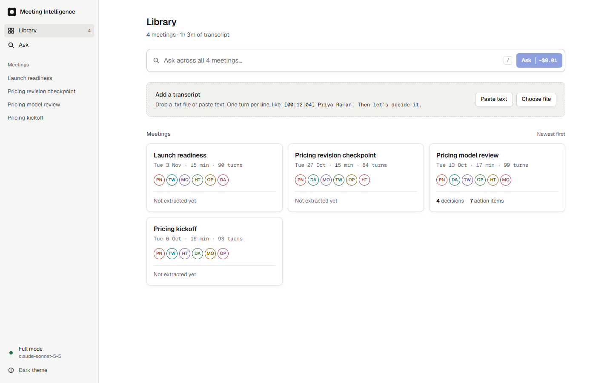
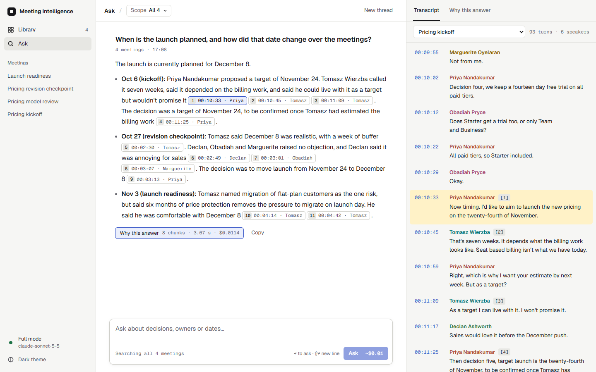
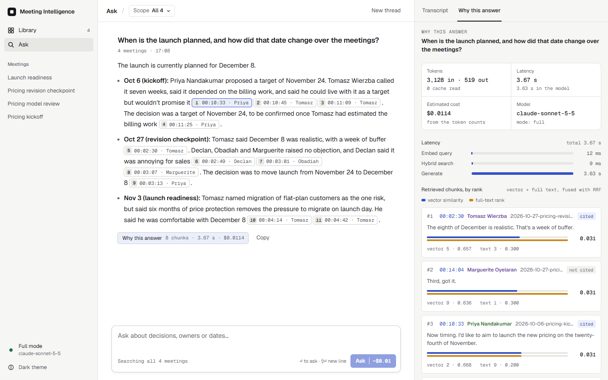
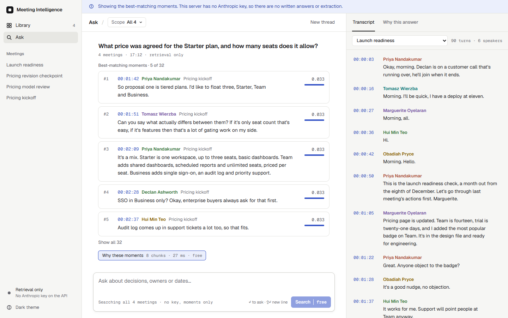
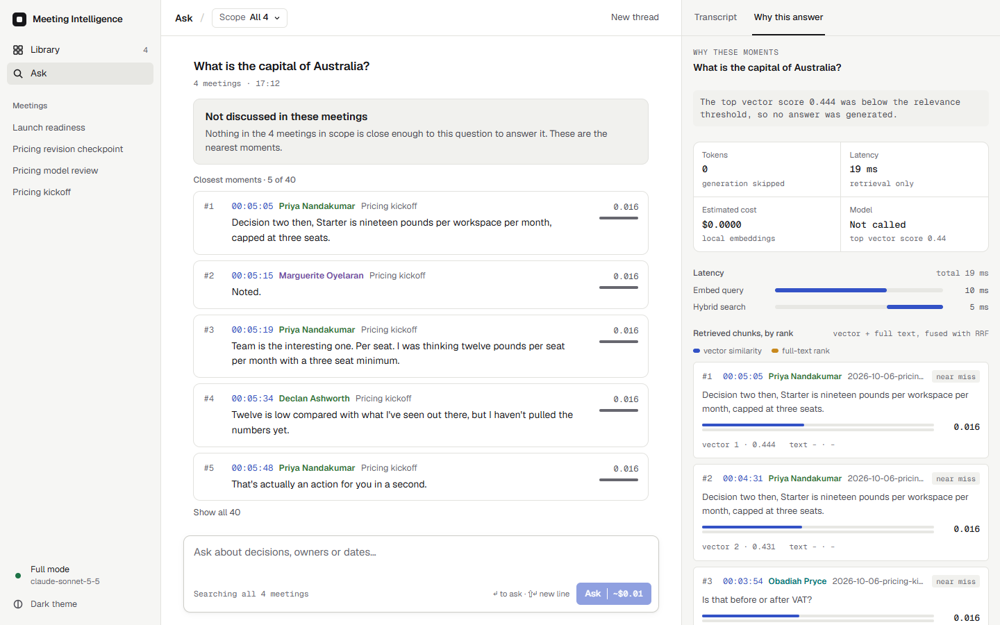
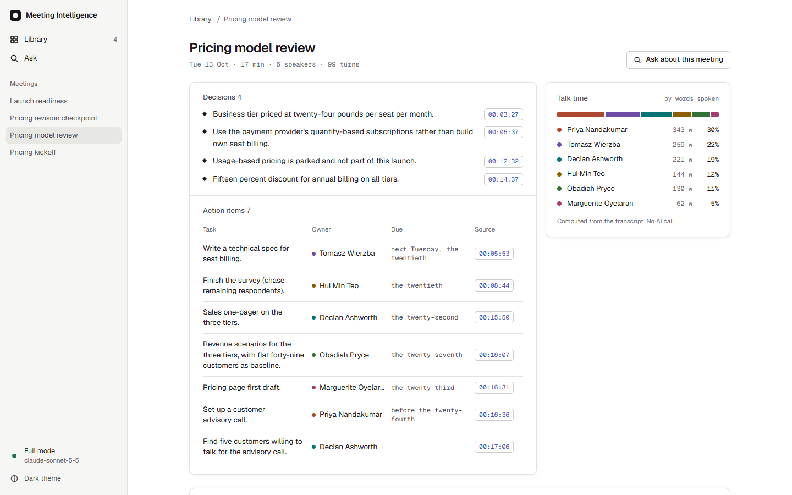
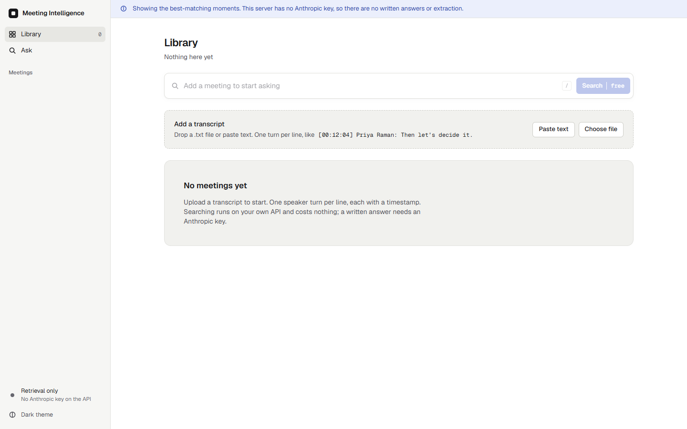
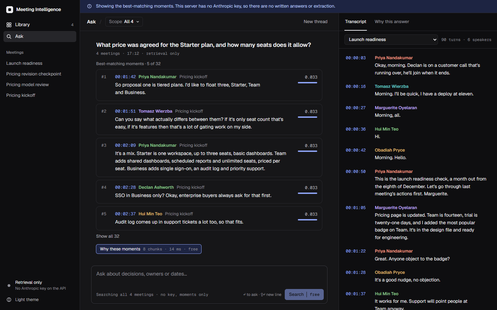
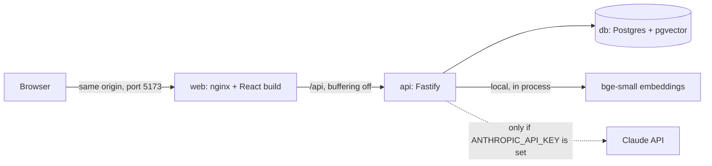

# Meeting Intelligence

Ask questions about your meeting transcripts and get answers that cite the exact moment something was said.

This is my submission for option 3 of the take-home brief (Meeting Intelligence System). The app has a React front end and a Fastify API, both in TypeScript, with Postgres and pgvector behind it.

The README follows the brief's sections a to i. Sections a, b and f describe what the code does. Sections c, d, e, g and h are my own account of the thinking, and are marked where they are not written yet. Longer reasoning for each decision is in `docs/adr/`.

## Screenshots

Taken from the running app. The full-mode shots use `claude-sonnet-5-5` with the four sample meetings loaded.



**Library.** Meeting cards show the date, length, speakers, and decision and action counts once a meeting has been extracted.



**Ask, full mode.** Every claim ends in a chip with the time and speaker. Clicking one scrolls the transcript to that turn and highlights it. Only citations that the server checked against the retrieved turns become chips.



**Why this answer.** Tokens, latency per stage, an estimated cost, and every retrieved chunk with its vector and full-text rank and score. Each chunk is marked cited or not cited.



**Retrieval-only mode (no key).** Same retrieval, no generated answer. The result is the best-matching speaker turns with timestamps, and the banner says why.



**Refusal.** A question about something the meetings never covered. The top vector score was below the threshold, so no model call was made. The nearest moments are still shown.



**Meeting page.** Decisions and action items extracted by Claude Haiku, each linked to the turn it came from. Talk time is computed from the transcript and uses no model.



**Empty state.**



**Dark theme.**

## a. Quick setup

You need Docker with Compose v2. Nothing else is required to run the app.

### Without a key

```
git clone https://github.com/christosgalaios/meeting-intelligence.git
cd meeting-intelligence
docker compose up --build
```

Open <http://localhost:5173>.

- The first build is slower because the embedding model is downloaded into the API image. After that, start-up needs no network.
- The API reports healthy only after the model has loaded and warmed up, and the web container waits for that. `docker compose ps` shows the state.
- Four sample meetings are loaded at start. Loading them never calls a model.
- With no key the app is in retrieval-only mode. You can upload transcripts, search across them, and see the best-matching speaker turns with scores. You do not get written answers or extracted decisions. See `docs/adr/0001-no-key-retrieval-only-default.md`.

### With your own Claude key

```
cp .env.example .env
# set ANTHROPIC_API_KEY=sk-ant-... in .env
docker compose up --build
```

Or pass it for one run: `ANTHROPIC_API_KEY=sk-ant-... docker compose up --build`.

- Answers use `claude-sonnet-5-5`. Extraction of decisions and action items uses `claude-haiku-5-5`.
- Nothing paid runs on its own. A paid call happens when you press Ask, upload a transcript, or press the extract button on a meeting. The button shows an estimate first. The sample meetings are never extracted until you press that button.
- One answer in the screenshots used 3,128 input and 519 output tokens, which is $0.0114 at the prices on record in `docs/spec.md`.
- The key is read by the API container only. It is never sent to the browser.

### Using it

- Upload a `.txt` file or paste text. One turn per line: `[00:12:04] Priya Raman: Then let's decide it.` The shorter `[12:04]` form also works. Files up to 2 MB.
- Ask across all meetings, or scope a question to one.
- Stop with `docker compose down`. Add `-v` to delete the database volume.
- The app has no login. All ports are bound to `127.0.0.1`, so it is reachable only from your own machine.

### Without Docker, for development

Needs Node 24.

```
docker compose up -d db
npm install
npm run dev --workspace apps/api    # API on 3001, in one terminal
npm run dev --workspace apps/web    # web on 5173 with /api proxied, in another
npm test                            # unit and API tests; the API tests need the db above
npm run eval                        # retrieval eval, keyless
```

More detail for the API is in `apps/api/README.md`.

## b. Architecture

Three containers. The browser talks only to nginx, which serves the React app and proxies `/api` to the API. The API owns the database, the embeddings and every model call.



**How a question is answered.**
1. The question is embedded locally. Postgres returns the 20 nearest chunks by vector and the 20 best chunks by full-text rank.
2. The two lists are fused with reciprocal rank fusion and the top 8 chunks are kept.
3. If the evidence is weak, the app refuses without calling a model.
4. Otherwise the turns inside those chunks go to Claude Sonnet, which answers with `[meeting#turn]` citations. Tokens stream to the browser as server-sent events.
5. The server checks every citation against the turns it retrieved. Unverified ones are dropped from the answer's citations and recorded.
6. Every question writes a trace row, which the "Why this answer" panel and `GET /api/traces/:id` both read.

**How a transcript is ingested.** The file is parsed into speaker turns, grouped into chunks of up to 6 turns or 180 words with a 2-turn overlap, embedded, and stored in one transaction. With a key, Claude Haiku then extracts decisions and action items in the background.

**Stack.**

| Layer | Choice |
|---|---|
| Language | TypeScript, strict mode, in both apps |
| API | Fastify 5, zod, Pino logging |
| Database | Postgres 17 with pgvector (HNSW) and full-text search |
| Embeddings | `Xenova/bge-small-en-v1.5`, 384 dimensions, run locally with `@huggingface/transformers` |
| Answers | `claude-sonnet-5-5` through the Anthropic SDK, streamed |
| Extraction | `claude-haiku-5-5`, structured output |
| Web | React 19, Vite, Tailwind 4, React Router, design tokens in CSS variables |
| Serving | nginx, same origin, no CORS |
| Tests | Vitest in both apps, Testing Library for the web |
| CI | GitHub Actions: typecheck, lint, tests, retrieval eval, build, compose smoke test, gitleaks |

More diagrams (ingest, ask, the SSE event order, the data model and the request lifecycle with its trace) are in `docs/architecture.md`.

## c. Productionising and scaling

[Christos writes this section]

## d. RAG and LLM approach

[Christos writes this section]

## e. Key technical decisions

[Christos writes this section]

## f. Engineering standards

What I followed:

- **Types.** TypeScript in strict mode with `noUncheckedIndexedAccess`. Every request body and every model output is checked with zod before it is used. The API checks each SSE event against the contract before sending it.
- **Tests.**
  - Unit tests for the parser, chunker, RRF, citations, extraction schema, config and log hygiene.
  - API tests run against a real Postgres with pgvector, using a fake embedder and a fake model, so they need no key. Each test file gets its own schema.
  - Web tests for the SSE client, the ask panel and the library.
  - The rule in `CLAUDE.md` is that a bug fix ships with a test that fails without the fix.
- **A retrieval eval, not just unit tests.** `npm run eval` runs 22 labelled questions (16 answerable, 6 unanswerable) through the real embedder and writes `evals/results/latest.json`. CI fails if recall@8 drops below 0.40, MRR below 0.33 or all-retrieved recall below 0.80. The gates come from measured results, not guesses. Current values are recall@8 0.4375, MRR 0.3605 and all-retrieved recall 0.849.
- **CI.** Typecheck, lint, tests, the eval and the build on every push. A separate web job. A compose smoke test that builds the stack from a clean checkout, waits for it to be healthy, and streams one question through both the API and nginx. All of it runs without a key.
- **Containers.** Multi-stage API image with the embedding model baked in (734 MB). Healthchecks on `db` and `api`. Ports on `127.0.0.1` only.
- **Observability.** Structured JSON logs with a request id on every line. A line per stage: `ingest.done`, `extract.done`, `ask.retrieved`, `ask.answered`. A trace row per question. A test fails if a log line at `info` contains transcript text, the question, an answer or a key-shaped string.
- **Security.** No CORS and same-origin serving. Transcript text is escaped and wrapped before it reaches a model, and model output is validated. A Content-Security-Policy on the web app. The key lives only in the API process, and CI fails the web build if its bundle contains `sk-ant`. gitleaks runs as a pre-commit hook and in CI.
- **Database.** Numbered SQL migrations, applied in a transaction at boot and safe to run twice.
- **Frontend.** Colours come only from design tokens, and ESLint fails the build on a hex colour outside `tokens.css`.
- **Process.** Work went through branches and pull requests. `CLAUDE.md` holds the rules the coding agents had to follow, including the ones above. Architecture decisions are written up as ADRs in `docs/adr/`.

What I skipped, on purpose, for a two-day build:

- **No authentication or rate limiting.** Loopback binding is the only protection. Anyone who can reach the API can spend the key.
- **No job queue.** Embedding on upload is synchronous, so a large transcript holds the request open. Extraction runs in-process after the response, and is not retried.
- **Contract types are copied by hand** from the API into the web app, instead of living in a shared package. The API tests are the source of truth if they drift.
- **No browser end-to-end tests.** The compose smoke test covers the built stack through nginx, but nothing drives the UI.
- **No metrics or tracing.** Logs and the per-question trace row only.
- **No test of answer quality.** The eval measures retrieval. There is no faithfulness or answer-correctness eval, and only 22 questions over four sample meetings.
- **No coverage threshold, no load testing, no deployment pipeline.**
- **The pre-commit secret scan skips itself if gitleaks is not installed.** The CI scan always runs.

## g. How I used AI tools

[Christos writes this section]

## h. What I'd do with more time

[Christos writes this section]

## i. A note on authorship

The brief asks for my thoughts, not an LLM's direct output, so here is what is whose.

- Sections c, d, e, g and h are the ones that carry my reasoning, and I write them myself.
- Sections a, b and f, the ADRs in `docs/adr/` and `docs/architecture.md` describe what the code does and why it was built that way. Claude Code drafted them from the code, the evals and my decision journal, and I check them against the code. [TODO: Christos confirms he has read and checked these before submitting]
- The code was written by AI coding agents under my direction. Section g says how, and lists the places I rejected or corrected what they produced.
- Every number in this README comes from the code, from `evals/results/latest.json`, or from a screenshot. Where I did not have a number, I have left a gap and said so.

## Known limits

- Only plain-text transcripts in the `[hh:mm:ss] Speaker: text` shape. No audio, WebVTT or SRT.
- English only: the full-text index uses the English configuration and the embedding model is English.
- The refusal threshold catches few unanswerable questions on its own (1 of 6 in the eval). In full mode the model does most of the refusing, and I have not measured it. See `docs/adr/0006-two-layer-refusal.md`.
- A citation check shows the model cited a turn it was given. It does not show that the turn supports the claim.
- Recall@8 is 0.4375 on a 16-question set. Treat the retrieval numbers as coarse.
- Prompt injection is mitigated, not solved. See `docs/adr/0009-transcripts-are-untrusted-input.md`.
