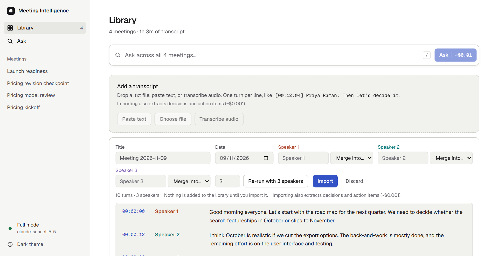
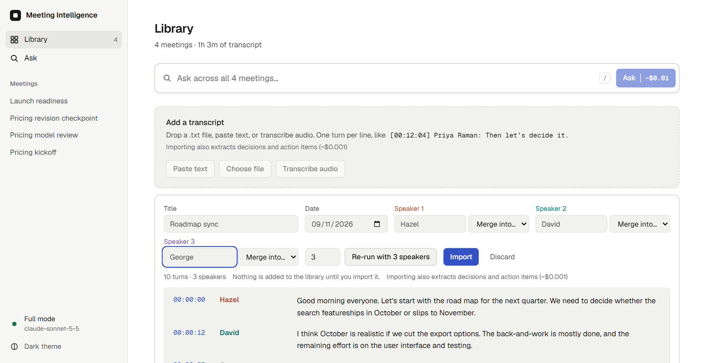
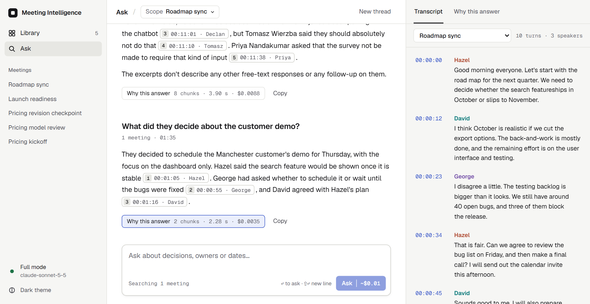
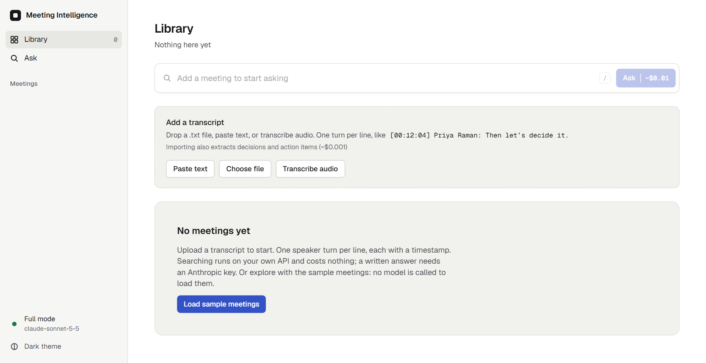
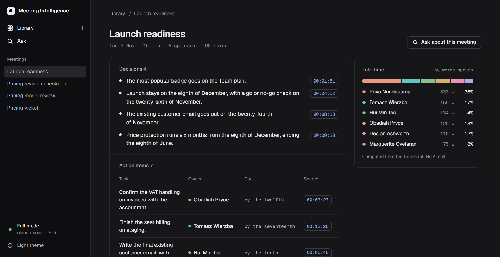
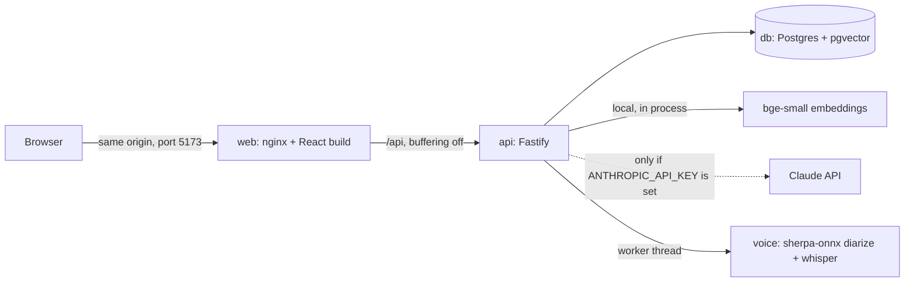

# Meeting Intelligence

Ask questions about your meeting transcripts and get answers that cite the exact moment something was said.

This is my submission for option 3 of the take-home brief (Meeting Intelligence System). The app has a React front end and a Fastify API, both in TypeScript, with Postgres and pgvector behind it.

The README follows the brief's sections a to i. Sections a, b and f describe what the code does. Sections c, d, e, g and h are my own account of the thinking, and are marked where they are not written yet. Longer reasoning for each decision is in `docs/adr/`.

## Screenshots

Taken from the running app. The full-mode shots use `claude-sonnet-5-5` with the four sample meetings loaded.


**Library.** Meeting cards show the date, length, speakers, and decision and action counts once a meeting has been extracted.


**Ask, full mode.** Every claim ends in a chip with the time and speaker. Clicking one scrolls the transcript to that turn and highlights it. Only citations that the server checked against the retrieved turns become chips.


**Why this answer.** Tokens, latency per stage, an estimated cost, and every retrieved chunk with its vector and full-text rank and score. Each chunk is marked cited or not cited.


**Retrieval-only mode (no key).** Same retrieval, no generated answer. The result is the best-matching speaker turns with timestamps, and the banner says why.


**Refusal.** A question about something the meetings never covered. The top vector score was below the threshold, so no model call was made. The nearest moments are still shown.


**Meeting page.** Decisions and action items extracted by Claude Haiku when the user asks, each linked to the turn it came from. Talk time is computed from the transcript and uses no model.



**Audio, transcribed.** Speaker detection and Whisper run on the API's own CPU, with no key and no cost. The test clip is three synthetic voices (`evals/voice/clip.wav`).



**Review before import.** A person names the speakers, merges any that were split, or re-runs with a set speaker count. Nothing is saved until Import, and the audio is never stored.



**Asking about a recorded meeting.** Once imported it is chunked, embedded and cited like any other transcript.



**Empty state.** Taken with the meeting list request answered empty in the browser, since the stack seeds the samples on start.



**Dark theme.**

## a. Quick setup

You need Docker with Compose v2. Nothing else is required to run the app.

### Without a key

```
git clone https://github.com/christosgalaios/meeting-intelligence.git
cd meeting-intelligence
docker compose up --build
```

Open <http://127.0.0.1:5173> (use the IP: the port is bound to 127.0.0.1 only, and `localhost` can resolve to IPv6 first).

- The first build is slower because the embedding model is downloaded into the API image. After that, start-up needs no network.
- The API reports healthy only after the model has loaded and warmed up, and the web container waits for that. `docker compose ps` shows the state. While it is still loading, `GET /api/health` answers 503.
- Four sample meetings are loaded at start. If the library is ever empty (for example after `docker compose down -v`), a **Load sample meetings** button calls `POST /api/seed` and loads them again. Loading them is safe to repeat and never calls a model.
- With no key the app is in retrieval-only mode. You can upload transcripts, search across them, and see the best-matching speaker turns with scores. You do not get written answers or extracted decisions. See `docs/adr/0001-no-key-retrieval-only-default.md`.

### With your own Claude key

```
cp .env.example .env
# set ANTHROPIC_API_KEY=sk-ant-... in .env
docker compose up --build
```

Or pass it for one run: `ANTHROPIC_API_KEY=sk-ant-... docker compose up --build`.

- Answers use `claude-sonnet-5-5`. Extraction of decisions and action items uses `claude-haiku-5-5`.
- Nothing paid runs on its own. A paid call happens when you press Ask, upload a transcript, or press the extract button on a meeting. The button shows an estimate first. The sample meetings are never extracted until you press that button.
- One answer in the screenshots used 3,128 input and 519 output tokens, which is $0.0114 at the prices on record in `docs/spec.md`.
- The key is read by the API container only. It is never sent to the browser.

### Using it

- Upload a `.txt` file or paste text. One turn per line: `[00:12:04] Priya Raman: Then let's decide it.` The shorter `[12:04]` form also works. Files up to 2 MB. A file that does not look like a transcript is rejected before anything is embedded: no timestamps on at least half its lines, fewer than 2 turns, binary content, or a turn over 2,000 words.
- Or use **Transcribe audio** on the library page. Pick a recording your browser can decode (tested with WAV; MP3 and M4A go through the same browser decoder but were not tested), wait for the draft, then review it: rename or merge speakers, or set the speaker count and re-run if the diarizer got it wrong. Press Import to add it. Nothing is added before that, and the audio is never stored. It runs locally with no key, at about 13.5 seconds per minute of audio. Measurements and limits are in `evals/voice/README.md` and `docs/adr/0011-local-diarized-speech-to-text.md`.
- Ask across all meetings, or scope a question to one.
- Stop with `docker compose down`. Add `-v` to delete the database volume.
- The app has no login. All ports are bound to `127.0.0.1`, so it is reachable only from your own machine.

### Without Docker, for development

Needs Node 24.

```
docker compose up -d db
npm install
npm run dev --workspace apps/api    # API on 3001, in one terminal
npm run dev --workspace apps/web    # web on 5173 with /api proxied, in another
npm test                            # unit and API tests; the API tests need the db above
npm run eval                        # retrieval eval, keyless
```

More detail for the API is in `apps/api/README.md`.

## b. Architecture

Three containers. The browser talks only to nginx, which serves the React app and proxies `/api` to the API. The API owns the database, the embeddings and every model call.



**How a question is answered.**
1. The question is embedded locally. Postgres returns the 20 nearest chunks by vector and the 20 best chunks by full-text rank.
2. The two lists are fused with reciprocal rank fusion and the top 8 chunks are kept.
3. If the evidence is weak, the app refuses without calling a model.
4. Otherwise the turns inside those chunks go to Claude Sonnet, which answers with `[meeting#turn]` citations. Tokens stream to the browser as server-sent events.
5. The server checks every citation against the turns it retrieved. Unverified ones are dropped from the answer's citations and recorded.
6. Every question writes a trace row, which the "Why this answer" panel and `GET /api/traces/:id` both read.

**How a transcript is ingested.** The file is parsed into speaker turns, grouped into chunks of up to 6 turns or 180 words with a 2-turn overlap, embedded, and stored in one transaction. With a key, Claude Haiku then extracts decisions and action items in the background.

**How audio is transcribed.** The browser decodes the recording to 16 kHz mono WAV and refuses anything over 30 minutes. The API queues it (one job at a time, at most 4 active) and a worker thread runs speaker segmentation, speaker embeddings and Whisper base.en on the CPU. The result is a draft the user reviews, renames and merges speakers in, and imports through the normal ingest path. Audio is never stored and jobs live in memory. See `docs/adr/0011-local-diarized-speech-to-text.md`.

**Stack.**

| Layer | Choice |
|---|---|
| Language | TypeScript, strict mode, in both apps |
| API | Fastify 5, zod, Pino logging |
| Database | Postgres 17 with pgvector (HNSW) and full-text search |
| Embeddings | `Xenova/bge-small-en-v1.5`, 384 dimensions, run locally with `@huggingface/transformers` |
| Answers | `claude-sonnet-5-5` through the Anthropic SDK, streamed |
| Extraction | `claude-haiku-5-5`, structured output |
| Speech-to-text | sherpa-onnx in a worker thread: pyannote segmentation 3.0, wespeaker resnet34, Whisper base.en int8. Local, English, no key |
| Web | React 19, Vite, Tailwind 4, React Router, design tokens in CSS variables |
| Serving | nginx, same origin, no CORS |
| Tests | Vitest in both apps, Testing Library for the web |
| CI | GitHub Actions: typecheck, lint, tests, retrieval eval, build, compose smoke test, gitleaks |

More diagrams (ingest, ask, the SSE event order, the data model and the request lifecycle with its trace) are in `docs/architecture.md`.

## c. Productionising and scaling

Today this is a single-tenant app that runs on one machine with no login. That is fine for a demo. Hosting it for real users needs the following, roughly in this order.

**1. Authorisation and rate limiting.** Anyone who can reach the API can spend the key, which is why every port is bound to localhost. Before any public URL I would add authentication, an owner on every meeting so one customer cannot read another's transcripts, and rate limits per user and per IP in front of the paid endpoints. The tables have no owner column yet, so this is a migration, not a flag.

**2. Safeguards on LLM spend.** Today the safeguard is that nothing paid runs without a click, and the estimated cost is shown before you click. With many users that is not enough. I would add a budget per user and per organisation, a cap on tokens per request, and a spend limit on the provider key as the last line of defence. The trace table already records the tokens for every question, so the usage data is there.

**3. Where to host it.** My preference is Cloudflare, because I know it from running Socialise. In a company I would first look at what is already in use and adapt to that. Nothing in the app depends on one provider. The three containers already exist with healthchecks, so the move is a container platform for `web` and `api`, a managed Postgres with pgvector, and a secrets manager for the key. Answers stream, so the load balancer's idle timeout has to be long enough not to cut them off.

**4. Slow work off the request.** Embedding runs inside the upload request, extraction runs in the API process with no retry, and the voice job queue lives in memory. In production all three become background jobs with a status, retries with a limit, and somewhere for failed jobs to land.

**5. Logging and error tracking.** The logs are structured and every question has a trace row, but in Docker they only go to the container's output. Hosted, I would make sure the logs are written and kept on the server, add Sentry or something similar for errors, and add metrics (retrieval latency, model latency, refusal rate, dropped citations) with alerts.

**6. More than one instance.** Migrations run at boot with no lock, so two API replicas starting together could both try to apply one. Voice jobs are held per instance. Both need changing before scaling out.

**7. Data protection.** Transcripts are personal data. A hosted version needs retention rules, deletion on request, a record of what is sent to the model provider, and a decision on regions. Questions are stored in the trace table, so it needs the same treatment.

## d. RAG and LLM approach

**LLM.** Answers use Claude Sonnet (`claude-sonnet-5-5`), streamed. Decisions and action items are extracted with Claude Haiku (`claude-haiku-5-5`) in one structured call per meeting. Answers combine several meetings and follow citation rules, and extraction is a simpler job over one transcript, so it gets the cheaper model (ADR 0008). The models were not compared on answer quality.

One option I considered was shipping an on-device LLM, so nobody would pay for API calls. I wasn't sure a reviewer would be comfortable putting in their own key, but I decided to build it with a hosted model because that is more production ready. I also considered building a demo mode first, without any key, but that would have taken more iteration. What the app does have is a real no-key mode: embeddings and voice transcription run locally, so without a key you still get real search results over your own transcripts, just not a written answer (ADR 0001).

**Embedding model.** `bge-small-en-v1.5`, 384 dimensions, run locally inside the API. Retrieval is real and free with or without a key. The trade-off is a small model whose similarity scores sit in a narrow band. Only this model was evaluated.

**Vector database.** Postgres with pgvector, with Postgres full-text search next to it. One database holds the meetings, turns, chunks and traces. A separate vector database would be a second system with nothing to gain at this size.

**Orchestration framework.** None. I wanted to keep things simple and straightforward. The flow is a handful of plain functions (embed the question, search, fuse, check, call the model, validate the citations), and it calls the Anthropic SDK directly. A framework would add a layer to learn and debug without doing anything those functions don't. The API wires its parts together by hand in one place (`buildServer`), which is also what lets the tests swap in a fake model and a fake embedder.

**Chunking.** Windows of whole speaker turns: up to 6 turns or 180 words, overlapping by 2 turns. A chunk never cuts a turn in half, so who said what is never lost, and the overlap keeps a question and its answer together when they fall either side of a boundary. The sizes are reasoned, not tuned (ADR 0004).

**Retrieval.** Each question fetches 20 chunks by vector similarity and 20 by full-text rank. Reciprocal rank fusion (k = 60) merges the two lists by position, because the two kinds of score are on different scales and can't be added. The top 8 chunks are kept. The full-text query matches any word of the question rather than every word: with every word required, natural questions matched almost nothing. The switch raised recall@8 from 0.583 to 0.604 and MRR from 0.625 to 0.667 (ADR 0005).

**Prompt and context.** A constant system prompt, so it can be cached. The user message holds the retrieved turns grouped by meeting, each with its id and timestamp, then the question. The model must answer only from those excerpts, cite every claim as `[meeting#turn]`, and reply exactly "Not discussed in these meetings." when the excerpts don't cover the question.

**Guardrails.**
- **Refusal in two layers.** If the best vector score is below 0.58 (and no chunk contains every word of the question), the app refuses without calling the model. That threshold is weak: it catches 1 of the 6 unanswerable eval questions, and raising it starts refusing real ones. The model's own refusal does most of the work. In one live run on 4 November, all 6 unanswerable questions were refused, 1 by the threshold and 5 by the model (ADR 0006).
- **Citations are checked on the server.** A citation is shown as a link only if that turn was in the excerpts the model was given. Anything else stays plain text and is recorded in the trace.
- **Transcripts are data, not instructions.** They are wrapped in tags, with `<` escaped so a speaker can't break out, and the prompt says to treat any instruction inside them as something a speaker said. I chose not to strip suspicious lines: no filter catches every phrasing, and deleting lines would change the meeting record. A sample transcript has a planted "ignore all previous instructions" line, and the model quotes it rather than following it.

**Quality.** A retrieval eval of 22 hand-labelled questions (16 answerable, 6 not) runs the real embedder in CI. It fails the build if recall@8 drops below 0.58 or MRR below 0.64. Current values: recall@8 0.604, MRR 0.667, and 0.849 for recall over everything the model is shown. These numbers moved during the build: a code review found the eval was ranking turns differently from the app, and once it used the app's own ranking, recall@8 went from 0.44 to 0.60. Sixteen answerable questions is a small set, so I treat the numbers as coarse. There is no check yet that an answer is supported by the turns it cites.

**Observability.** Structured logs with a request id on every line, and one trace row per question with the retrieved chunks and their scores, the model, tokens, timings and any dropped citations. The "Why this answer" panel shows that trace in the UI.

## e. Key technical decisions

Each of these has an ADR in `docs/adr/` with the options that were rejected.

- **Option 3, Meeting Intelligence.** I have worked on similar projects to do with meetings, so it seemed like a good learning opportunity.
- **Build it like a proper product, with your own key.** We looked at running answers through my Claude subscription instead of an API key. I decided against it and built it like a proper product: the shipped app uses the reviewer's own key, and there is no hosted demo, since that would put my key behind a public URL.
- **No key still means real results.** The first plan used canned answers when there was no key. A reviewer agent flagged it, and I went with real retrieval instead, so a reviewer without a key can still test it on their own transcripts.
- **Every paid call starts with a click,** and shows its estimated cost first. Seeding the sample meetings never calls a model.
- **Check input before it reaches the parser, the embedder or a model.** When I went through the build decisions, I asked whether we were validating input. A file with one valid line and a lot of junk was being accepted, embedded and sent to extraction. There is now a validation step that rejects that before anything is processed.
- **Two days, with a cut list.** I capped the build at two days and wrote what was cut into section h, instead of half-building it.
- **Gates from measurements.** The CI thresholds for the eval come from measured results, not guesses, so a regression fails the build.
- **A plain UI.** The interface is kept plain and distraction-free, so the focus stays on reading the text.
- **Voice, added back.** Voice was listed as a bonus, and I like going the extra mile. It was also something we had already worked on before, so it was familiar. It runs on-device, free and with no key, and a person reviews the speakers before anything is saved, because similar voices get mixed up (ADR 0011).

## f. Engineering standards

What I followed:

- **Types.** TypeScript in strict mode with `noUncheckedIndexedAccess`. Every request body and every model output is checked with zod before it is used. The API checks each SSE event against the contract before sending it.
- **Tests.**
  - Unit tests for the parser, chunker, RRF, citations, extraction schema, config and log hygiene.
  - API tests run against a real Postgres with pgvector, using a fake embedder and a fake model, so they need no key. Each test file gets its own schema.
  - Web tests for the SSE client, the ask panel, the library, the upload and voice flows and the paid extract button (its cost estimate, one request per click, disabled while pending).
  - Coverage is measured with `npm run test:coverage --workspace apps/api` (or `apps/web`) and has no threshold. On 2026-11-04: API 83.8% of statements and 85.1% of lines, web 70.2% and 72.3%.
  - The rule in `CLAUDE.md` is that a bug fix ships with a test that fails without the fix.
- **A retrieval eval, not just unit tests.** `npm run eval` runs 22 labelled questions (16 answerable, 6 unanswerable) through the real embedder and writes `evals/results/latest.json`. The eval ranks turns the way the app does, including the per-turn rescoring step. CI fails if recall@8 drops below 0.58, MRR below 0.64 or all-retrieved recall below 0.80. The gates come from measured results, not guesses. Current values are recall@8 0.6042, MRR 0.6671 and all-retrieved recall 0.849.
- **CI.** Typecheck, lint, tests, the eval and the build on every push. A separate web job. A compose smoke test that builds the stack from a clean checkout, waits for it to be healthy, and streams one question through both the API and nginx. All of it runs without a key.
- **Containers.** Multi-stage API image with the embedding model and the voice models baked in (about 725 MiB on the image filesystem, 216 MiB of it voice). Healthchecks on `db`, `api` and `web`. The `api` check passes only when the database answers and the embedding model is loaded. `LOG_LEVEL`, `RETRIEVAL_MIN_SCORE` and the voice limits can be set in `.env` and reach the container. Ports on `127.0.0.1` only.
- **Observability.** Structured JSON logs with a request id on every line. A line per stage: `boot.migrated`, `ingest.done`, `extract.done`, `ask.retrieved`, `ask.answered`. Health probes are logged at `warn`, so they do not drown the rest. Every API error carries the request id, and the web app shows it as `Ref: <id>`. A trace row per question. A test fails if a log line at `info` contains transcript text, the question, an answer or a key-shaped string.
- **Security.** No CORS and same-origin serving. Uploads are format-checked before anything is embedded. Transcript text is escaped and wrapped before it reaches a model, and model output is validated. A Content-Security-Policy on the web app. The key lives only in the API process, and CI fails the web build if its bundle contains `sk-ant`. gitleaks runs as a pre-commit hook and in CI.
- **Database.** Numbered SQL migrations, applied in a transaction at boot and safe to run twice.
- **Frontend.** Colours come only from design tokens, and ESLint fails the build on a hex colour outside `tokens.css`.
- **Process.** Work went through branches and pull requests. `CLAUDE.md` holds the rules the coding agents had to follow, including the ones above. Architecture decisions are written up as ADRs in `docs/adr/`.

What I skipped, on purpose, for a two-day build:

- **No authentication or rate limiting.** Loopback binding is the only protection. Anyone who can reach the API can spend the key.
- **No durable job queue.** Embedding on upload is synchronous, so a large transcript holds the request open. Extraction runs in-process after the response, and is not retried. Audio transcription has an in-memory queue (one job at a time, 4 active at most) whose jobs are lost if the API restarts.
- **Voice is thinly tested.** Speaker identification is weak on similar voices: on three similar female voices it found 1, 2 or 4 speakers depending on the threshold, which is why there is a review step. I tested it only on synthetic text-to-speech voices, never on real meeting audio. Recordings over 30 minutes are refused because memory was measured only up to a 95 second clip. English only.
- **Contract types are copied by hand** from the API into the web app, instead of living in a shared package. The API tests are the source of truth if they drift.
- **No browser end-to-end tests.** The compose smoke test covers the built stack through nginx, but nothing drives the UI.
- **No metrics or tracing.** Logs and the per-question trace row only.
- **No test of answer quality.** The eval measures retrieval. There is no faithfulness or answer-correctness eval, and only 22 questions over four sample meetings.
- **No coverage threshold, no load testing, no deployment pipeline.**
- **The pre-commit secret scan skips itself if gitleaks is not installed.** The CI scan always runs.

## g. How I used AI tools

**My role.** Most of the code was written by AI agents in Claude Code. I made the product and scope decisions, set the rules the work had to follow, and decided what was done. An orchestrating Claude session ran the checks I set: it gave work to the agents, never accepted an agent's own "done", and sent work back. My own time was roughly 6 hours spread over three days: two days on the core build, and the third on polish and documentation.

**The setup.**
- **One planner, separate builders, an independent reviewer.** A planning model wrote the spec from the brief and my constraints. Sonnet agents built the backend and frontend to it. An Opus reviewer, given the brief but not my conclusions, reviewed the plan before building and the code after.
- **Rules in the repo.** `CLAUDE.md` lists what every agent must do: the key never leaves the API, no canned answers, validate model output, no automatic LLM calls, a test with every bug fix, show test output before saying done.
- **Checks that don't trust reports.** Run the eval, run the app, look at the build. gitleaks scans for secrets before every commit and in CI.
- **A decision walkthrough.** Claude put 12 build decisions in front of me with their trade-offs. I kept all 12 and raised the input validation question, which became a fix.

**Decisions that were mine.** Option 3, because I'd worked on meeting projects before. Building it like a proper product with your own key, after looking at the subscription route. The two-day cap. No hosted demo, and my development key used only for building, screenshots and the video, on an account with a $1 spend limit. Going with real retrieval when there's no key. Adding voice back, with proper speaker identification. The plain UI. Asking for a cold code review against the brief. Keeping the documentation in step with every scope change.

**What the reviews and checks caught,** and who caught it:
1. **Canned answers as the no-key default** (reviewer agent, in the plan).
2. **CORS open to any origin,** so any web page could spend the key through the reviewer's browser, plus 13 other issues CI couldn't see, including a 2.1 GB image and a fake lint step (independent Opus review of the backend).
3. **A full-text query that matched almost nothing,** because it required every word (the orchestrating session ran the eval).
4. **Seeding that triggered four paid extraction calls** when a key was set (the orchestrating session).
5. **An agent waiting on a build that had already failed** (the orchestrating session checked the artefacts).
6. **An eval that ranked turns differently from the app** (the cold review I asked for).
7. **Input that wasn't validated before embedding** (me, in the walkthrough).

**Do's and don'ts.**
- Do give an agent a spec with acceptance checks. Don't accept "done" from the agent that did the work.
- Do check artefacts, not reports. Most of the catches above came from running the thing.
- Do get reviews from a model that hasn't seen the author's reasoning.
- Do keep the rules in a file the agents read every time, rather than repeating them in chat.
- Don't let an agent decide anything that spends money, exposes a key or changes who can reach the app.

**Learning what I shipped.** Agents write code faster than I can read it. I own the results, and I study and learn. Before writing this up, I went through the parts of the system I couldn't yet explain (embeddings, chunking, hybrid search and RRF, the eval metrics, refusal, prompt injection and citation checks) until I could. In a normal working environment I would carry on until I knew all of it.

**Repeatable.** The spec, `CLAUDE.md`, the ADRs, the eval and CI are all in the repo. A new person or a new agent gets the rules and the reasons, and the eval fails the build if retrieval gets worse.

## h. What I'd do with more time

**With one more day,** I would focus on testing and edge cases, not features, and on reading and understanding the code more. The goal would be more confidence that the tool is reliable.

**Accuracy.** Test more and find ways to improve the results: a bigger eval set built from real questions, a check that each answer is supported by the turns it cites, tuning the chunk size, and trying a reranker. Each change measured with the eval, one at a time.

**Audio.** Find out whether the transcription is good enough for real use. So far it has only been tested on synthetic voices, in clips under two minutes, with nobody talking over anybody. Next is real conversations with several people and overlapping voices, measuring the word error rate and how often speakers get mixed up.

**Who the users are.** I would question who the expected users are, and whether they care about cost. If it's a product someone is paying for, I would tidy up the front end and hide what end users don't need: the cost on every button, the "Why this answer" panel, and the numbers behind it. They are in this demo on purpose, for transparency. In a product they would move to an admin or support view.

**Organising meetings.** Archive meetings, and group them into projects. As the library grows, more near-misses compete for the same top 8 chunks, so asking within a project gives cleaner answers. The cost per question stays flat, because it always sends the same number of chunks. You can already pick which meetings a question searches. A project would make that selection something you save. A calendar to browse past meetings would help too, since each meeting already has a date.

**A connect layer,** for input or output. In: pull transcripts from Zoom, Teams or Google Meet. Out: send action items to Slack, email or a ticket tracker, always with a person confirming first.

**Other LLM providers.** Support for more than one provider, so it isn't locked to Anthropic, or an on-device model self-hosted on AWS. That is an option, and it depends on cost, for example if we wanted to keep it free.

**From the original cut list.** WebVTT and other transcript formats, speaker and date filters, end-to-end tests that drive the UI, and a shared types package between the API and the web app.

Hosting it for real users is section c.

## i. A note on authorship

The brief asks for my thoughts, not an LLM's direct output, so here is what is whose.

- Sections c, d, e, g and h carry my reasoning and my decisions. I gave them in my own words during the build, in chat and in my notes. Claude Code wrote them up from those, and from the decision journal for the facts. Where a reason comes from an ADR rather than from me, it is written as the design's reason, not mine.
- Sections a, b and f, the ADRs in `docs/adr/` and `docs/architecture.md` describe what the code does and why it was built that way. Claude Code drafted them from the code, the evals and my decision journal. I have read them and checked them against the code.
- The code was written by AI coding agents under my direction. Section g says how, and what the reviews and checks caught, with who caught each one.
- Every number in this README comes from the code, from `evals/results/latest.json`, or from a screenshot. Where I did not have a number, I have left a gap and said so.

## Known limits

- Transcripts are plain text in the `[hh:mm:ss] Speaker: text` shape, or audio transcribed locally (English, up to 30 minutes, speakers labelled by diarization) and reviewed before import. No WebVTT or SRT.
- Voice: similar voices can be merged or split by the diarizer. Set the speaker count and re-run, or merge and rename in the review step. Memory is measured only up to a 95 second clip (570 MB peak), so recordings over 30 minutes are refused rather than attempted. One recording is transcribed at a time; the API holds at most four. An API restart loses a job in progress.
- English only: the full-text index uses the English configuration and the embedding model is English.
- The refusal threshold catches few unanswerable questions on its own (1 of 6 in the eval). In full mode the model does most of the refusing. I measured it once, live, on 2026-11-04: all 6 unanswerable questions were refused (1 by the threshold, 5 by the model), see `evals/results/manual-refusal-and-injection-2026-11-04.jsonl`. That is one run on 6 questions, not a rate. See `docs/adr/0006-two-layer-refusal.md`.
- A citation check shows the model cited a turn it was given. It does not show that the turn supports the claim.
- Recall@8 is 0.6042 on a 16-question set. Treat the retrieval numbers as coarse.
- Migrations take no advisory lock, so two API replicas starting at once could both try to apply the same migration. The app runs as one replica.
- A few components are long (`WhyThisAnswer` 246 lines, `UploadDropzone` 217, `AskPage` 185, `MeetingSummaryCard` 179). They are mostly JSX, and splitting them was not worth the regression risk in a two-day build.
- The nginx `/assets/` location does not send the CSP and frame headers (an `add_header` in a location replaces the inherited ones). It serves only static JS and CSS, which are not documents.
- Answer and extraction `max_tokens` (1024 and 4096) are constants in `apps/api/src/llm/client.ts`, not settings.
- Prompt injection is mitigated, not solved. See `docs/adr/0009-transcripts-are-untrusted-input.md`.
