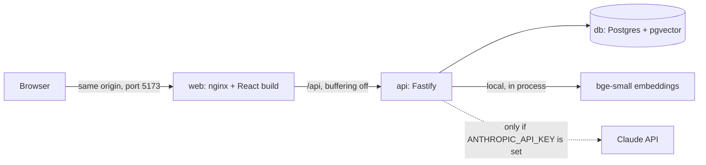
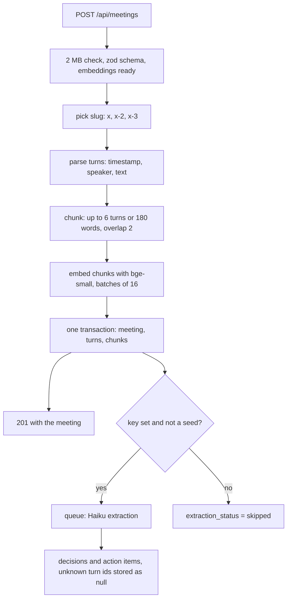
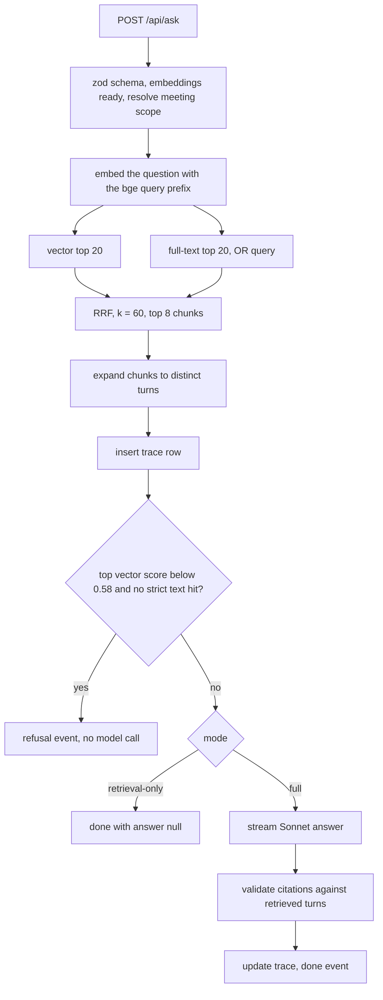
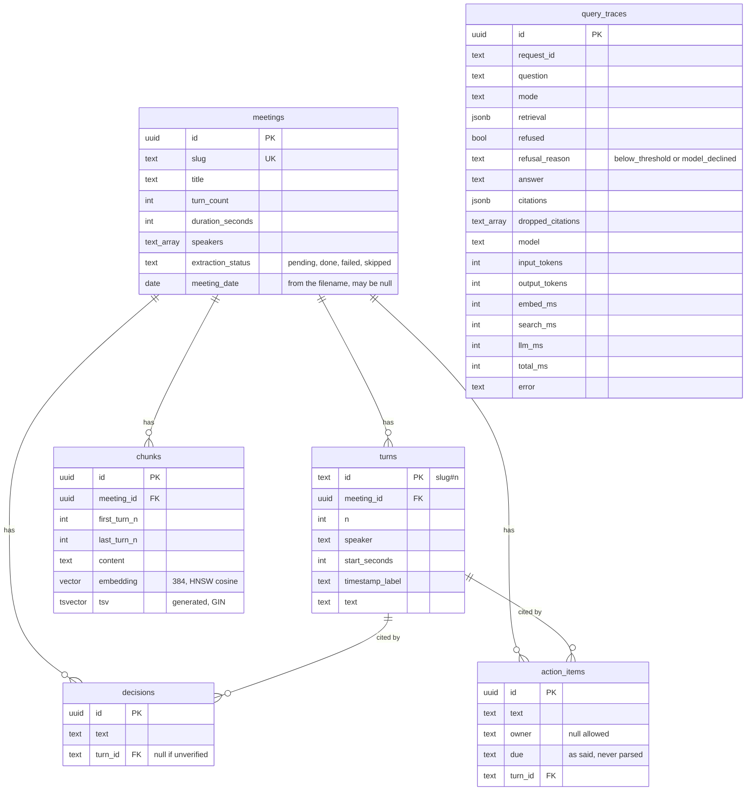

# Architecture

How the pieces fit and what happens on each request. The decisions behind it are in `docs/adr/`. The frozen API contract is in `docs/spec.md`, section 5.

## Containers

Three containers, started by `docker compose up`. Only the web container talks to a browser, and every port is bound to `127.0.0.1`.

- `web` serves the static React app and proxies `/api` to the API. The API sends no CORS headers (ADR 0010).
- `api` owns the database, the embeddings and every model call. The key exists only in this process.
- `db` is `pgvector/pgvector:pg17`.

## Ingest

An upload is parsed, chunked, embedded and stored in one request. Extraction runs after the response and only when a key is set.

- Turn ids are `<slug>#<n>`. The slug comes from the filename, so the same id is used in the database, the prompt and the UI anchor.
- Embedding is synchronous. A large file holds the request open.
- A pending extraction that is left over when the process dies is marked `failed: interrupted` at the next boot. Extraction is never retried automatically.
- Sample transcripts are loaded at start when `SEED_ON_START=true`. Seeding never calls the model.

## Ask

## SSE event sequence

`POST /api/ask` answers with `text/event-stream`. Each event is `event: <type>` and `data: <json>`. The API parses every event against the contract schema before sending it.

| Path | Events, in order |
|---|---|
| Full mode, answered | `meta`, `sources`, `token` (many), `done` |
| Full mode, below threshold | `meta`, `sources`, `refusal`, `done` (answer is `Not discussed in these meetings.`) |
| Retrieval-only | `meta`, `sources`, `done` (answer is `null`) |
| Failure after the stream opens | `meta`, `sources`, then `error` in place of `done` |

- `meta`: trace id, mode, answer model.
- `sources`: the 8 ranked chunks with their vector, text and RRF scores, and the turns inside them. Each turn carries a score. [TODO: confirm what the turn score is once `feat/polish` is merged. On `main` it is the best RRF score of a containing chunk. `feat/polish` changes it to the cosine similarity of the turn text to the question.]
- `token`: a piece of answer text.
- `done`: the final answer, the valid citations, the dropped citation ids, the refusal reason, token usage and timings.
- Request errors found before the stream opens (bad input, unknown meeting, embeddings not ready) are plain JSON with status 400, 404 or 503.
- The stream sets `Cache-Control: no-cache` and `X-Accel-Buffering: no`, and nginx has proxy buffering off, so tokens reach the browser as they are produced.
- If the client disconnects, the API aborts the upstream model stream so it stops costing tokens.

## Data model

- `query_traces` has no foreign key. It holds a copy of what was retrieved and answered, so a trace survives a deleted meeting.
- Migrations are numbered SQL files in `apps/api/migrations/`. Each runs in a transaction at boot and is recorded in `schema_migrations`, so a second run applies nothing.

## Request lifecycle and the trace

Follow one question through `POST /api/ask` in full mode.

1. Fastify gives the request a uuid and returns it as `x-request-id`. Every log line for the request carries `reqId`, `route` and `method`.
2. The body is checked against `AskRequest` (question up to 1000 characters). A bad body is `400 VALIDATION`. If the embedding model is still warming up, it is `503 EMBEDDINGS_NOT_READY`.
3. A meeting scope, if given, is resolved by uuid or slug. An unknown one is `404`.
4. The question is embedded, then vector and full-text candidates are fetched in parallel and fused. Timings are kept as `embedMs` and `searchMs`.
5. The retrieved chunks are expanded to turns, and the refusal rule is applied.
6. A row is inserted in `query_traces` now, with the request id, question, mode and retrieved chunks. A crash later still leaves a row. The API logs `ask.retrieved` (candidate counts, top vector score, whether it was below threshold, timings).
7. The response switches to a stream. `meta` and `sources` are sent.
8. In full mode, the retrieved turns are grouped by meeting, escaped and sent to Sonnet. Tokens are forwarded as `token` events.
9. When the stream ends, the server checks `stop_reason`. `refusal` becomes an `error` event. `max_tokens` keeps the text and logs a warning.
10. The server detects a model refusal, parses `[slug#n]` citations and splits them into valid and dropped.
11. The trace row is updated once: answer, valid citations, dropped citations, model, token counts, `llm_ms`, `total_ms`. The API logs `ask.answered`. The `done` event is sent.
12. On any failure after step 6 the trace gets an `error` and the client gets an `error` event with a generic message. The detail goes to the log only.

The same data is shown two ways:
- The "Why this answer" panel in the UI, fed by the `meta` and `done` events.
- `GET /api/traces/:id`, which returns the stored trace. It still works after a reload, and a reviewer can `curl` it.

Logs are structured JSON from Pino. At `info` level they never contain the API key, transcript text, chunk content, answers or the question. A test fails if they do (`apps/api/test/logging.test.ts`). The question is stored in `query_traces`, which is data in the database, not a log line.
