# Screenshots

All screenshots, taken from the running app. The full-mode shots use `claude-sonnet-5-5` with the four sample meetings loaded.

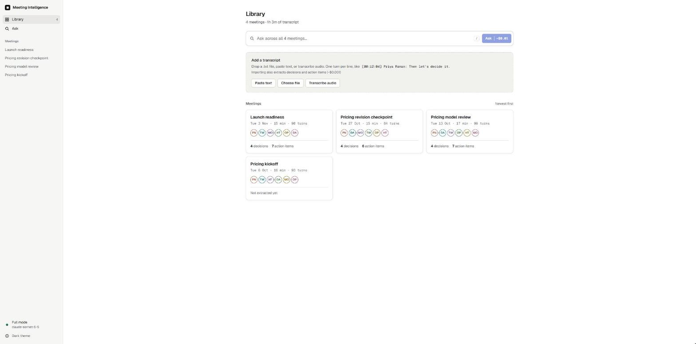

**Library.** Meeting cards show the date, length, speakers, and decision and action counts once a meeting has been extracted.

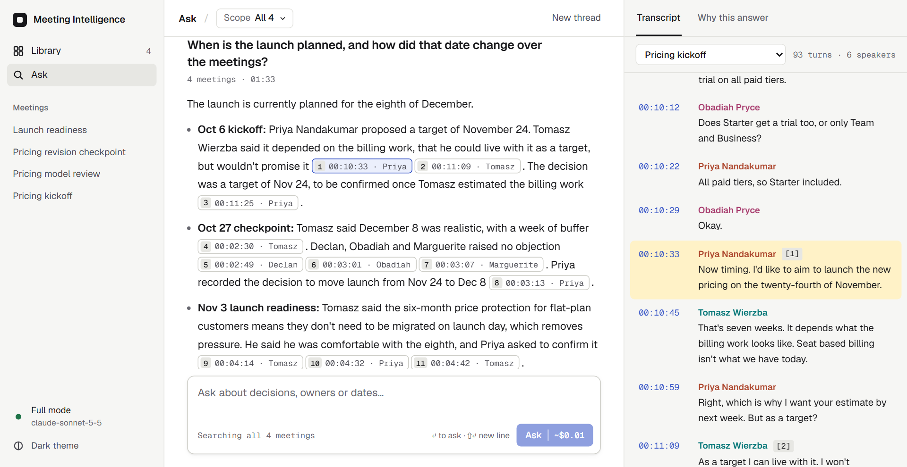

**Ask, full mode.** Every claim ends in a chip with the time and speaker. Clicking one scrolls the transcript to that turn and highlights it. Only citations that the server checked against the retrieved turns become chips.

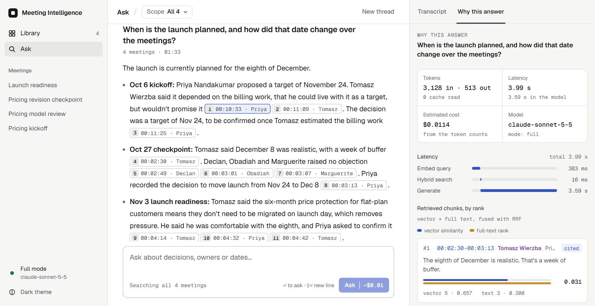

**Why this answer.** Tokens, latency per stage, an estimated cost, and every retrieved chunk with its vector and full-text rank and score. Each chunk is marked cited or not cited.

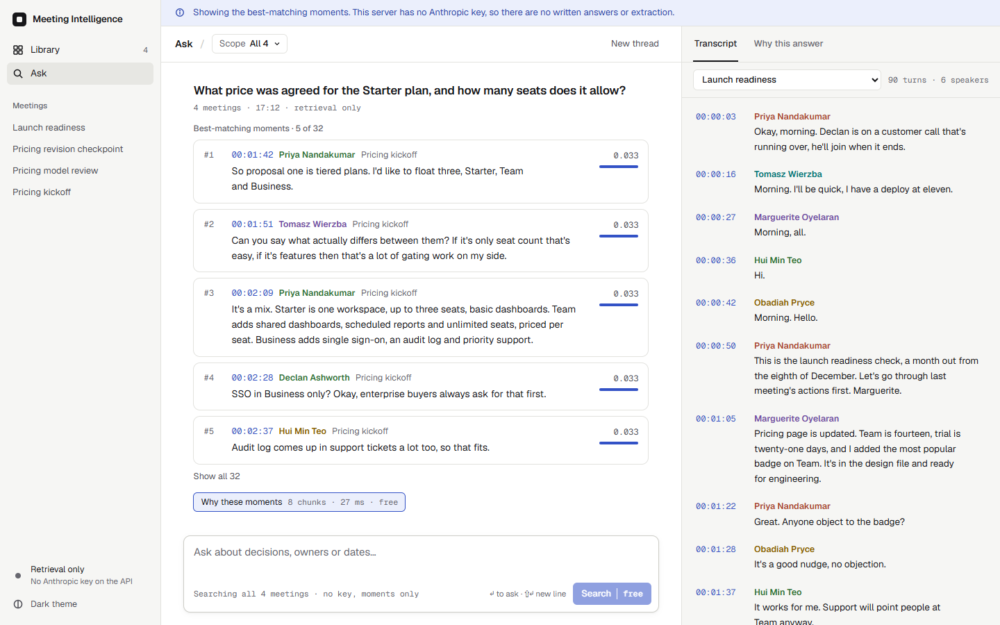

**Retrieval-only mode (no key).** Same retrieval, no generated answer. The result is the best-matching speaker turns with timestamps, and the banner says why.

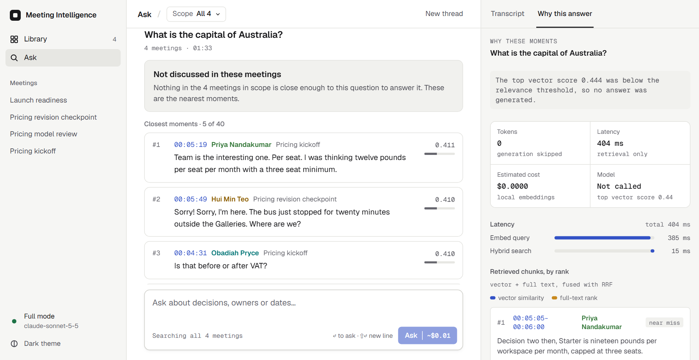

**Refusal.** A question about something the meetings never covered. The top vector score was below the threshold, so no model call was made. The nearest moments are still shown.

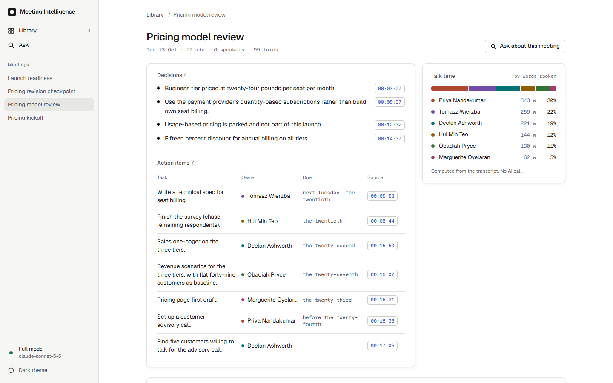

**Meeting page.** Decisions and action items extracted by Claude Haiku when the user asks, each linked to the turn it came from. Talk time is computed from the transcript and uses no model.

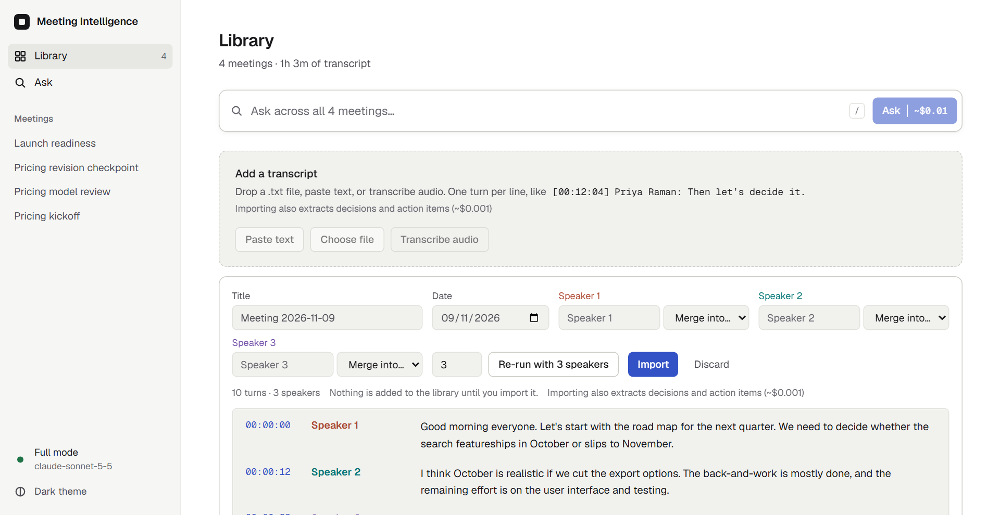

**Audio, transcribed.** Speaker detection and Whisper run on the API's own CPU, with no key and no cost. The test clip is three synthetic voices (`evals/voice/clip.wav`).

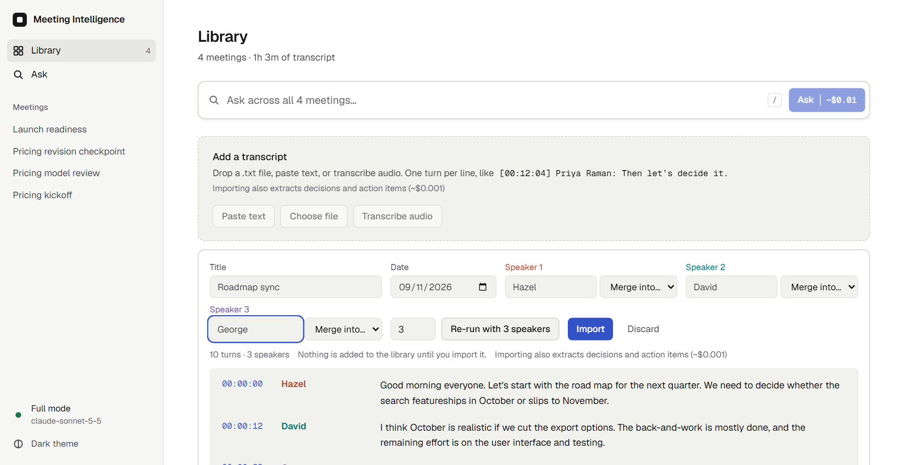

**Review before import.** A person names the speakers, merges any that were split, or re-runs with a set speaker count. Nothing is saved until Import, and the audio is never stored.

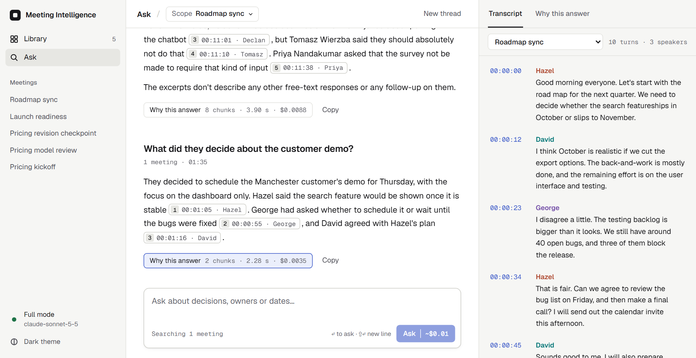

**Asking about a recorded meeting.** Once imported it is chunked, embedded and cited like any other transcript.

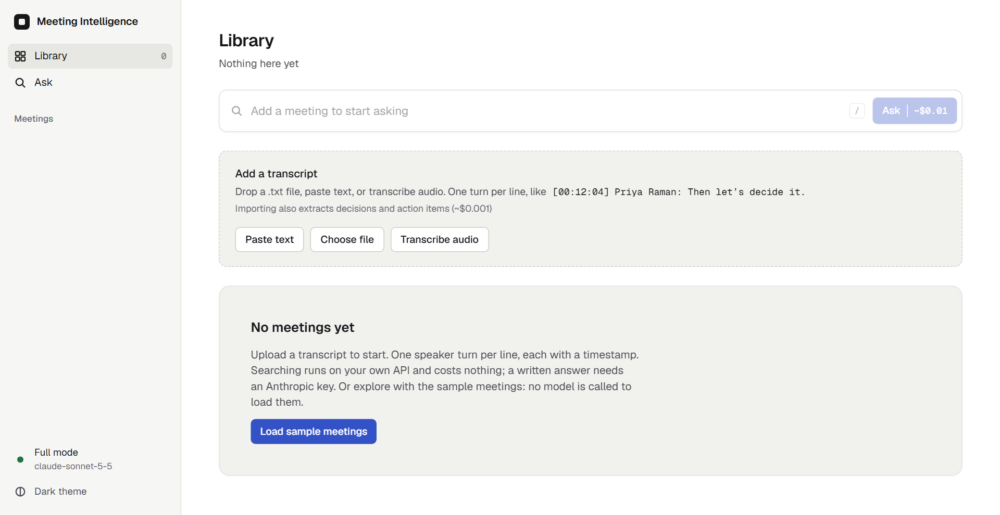

**Empty state.** Taken with the meeting list request answered empty in the browser, since the stack seeds the samples on start.

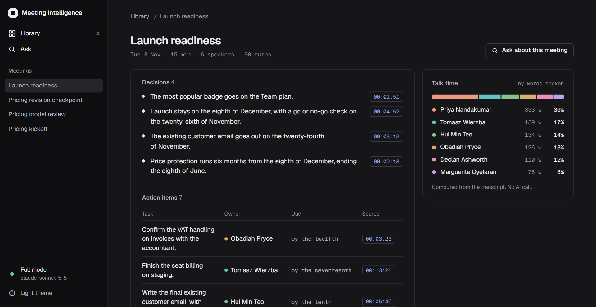

**Dark theme.**
